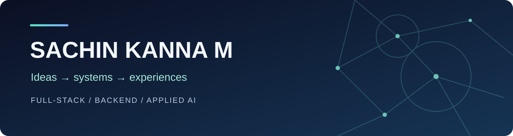

<div align="center">

### Hey, I'm Sachin 👋

Computer Science Engineering student at **KPRIET**, building products and exploring how thoughtful engineering turns ideas into useful software.

[](https://www.linkedin.com/in/sachinkanna12)
[](mailto:sachinkannasankar@gmail.com)
[](https://leetcode.com/u/sachinkanna12/)

</div>

---

## ✦ A little about me

I enjoy working across the product, from the interface someone sees to the backend decisions that make it work. My interests include **full-stack development**, **backend systems**, and **applied AI**, especially retrieval and memory.

```text
CURRENTLY EXPLORING
├── Backend engineering   APIs · databases · reliability
├── Applied AI            retrieval · context · useful tools
└── Growing as a builder  Java DSA · testing · system design
```

## ◈ Projects I've built

### 🎨 [Giggle Gallery](https://github.com/Sachinkanna07/Giggle-Gallery) · A marketplace for digital art

A marketplace bringing collectors and artists together, with buyer, seller and admin workflows, fixed-price checkout and auctions.

`Next.js` `TypeScript` `PostgreSQL` · [Visit the demo ↗](https://giggle-gallery-pi.vercel.app/)

> Payments are configured in test mode.

### 🧠 [ContextOS](https://github.com/Sachinkanna07/ContextOS) · Memory for AI applications

A local-first memory and context runtime exploring retrieval, privacy boundaries and connections to language models.

`Python` `SQLite` `MCP` · [Explore the repository ↗](https://github.com/Sachinkanna07/ContextOS)

### 🌾 [KISH](https://github.com/Sachinkanna07/Kish) · Procurement, designed for mobile

A bilingual English–Tamil prototype following a farmer's journey through booking and procurement workflows.

`React` `TypeScript` `PWA` · [Visit the demo ↗](https://kish-app.vercel.app/)

### 🏫 [Civora](https://github.com/Sachinkanna07/Civora) · Campus life in one place

An Android campus app bringing information and workflows for students and campus teams together.

`Kotlin` `Jetpack Compose` `Firebase` · [Explore the repository ↗](https://github.com/Sachinkanna07/Civora)

<details>
<summary><b>More experiments and prototypes</b></summary>
<br>

- 💬 [Sachin AI Chat](https://github.com/Sachinkanna07/AI-app) — a lightweight Streamlit and Gemini chat baseline.
- 🧩 [Solvynk](https://github.com/Sachinkanna07/solvynk) — a fixture-based prototype connecting problems and builders.

</details>

Each repository describes its own setup, current state and limitations.

## ⚙️ Tools I work with


---

<div align="center">

**Open to learning, collaborating and software engineering opportunities.**

[Let's connect on LinkedIn](https://www.linkedin.com/in/sachinkanna12) · [Send me an email](mailto:sachinkannasankar@gmail.com)

<sub>Build → Learn → Improve → Share</sub>

</div>
