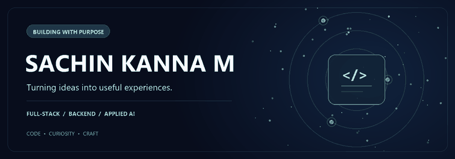
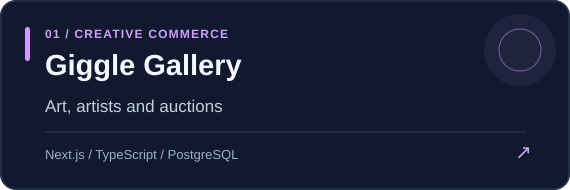
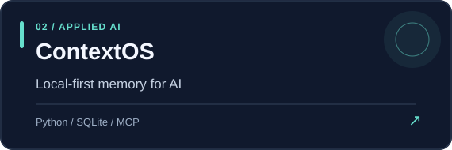
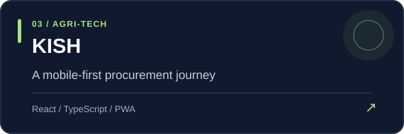
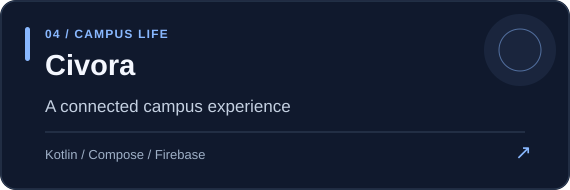

<p align="center">
  
</p>

<div align="center">

### Hi, I'm Sachin 👋

**Computer Science Engineering student at KPRIET**  
I enjoy taking an idea from an early concept to an experience people can use.

[](https://www.linkedin.com/in/sachinkanna12)
[](mailto:sachinkannasankar@gmail.com)
[](https://leetcode.com/u/sachinkanna12/)

</div>

---

## 01 &nbsp; / &nbsp; The work

I like projects that bring product thinking and engineering together: a useful interface, clear workflows, and the systems behind them.

<a href="https://github.com/Sachinkanna07/Giggle-Gallery"></a>
<a href="https://github.com/Sachinkanna07/ContextOS"></a>

**[Giggle Gallery](https://github.com/Sachinkanna07/Giggle-Gallery)** · Art discovery, seller workflows, checkout and auctions. [Visit demo ↗](https://giggle-gallery-pi.vercel.app/)  
<sub>Payments use test mode.</sub>

**[ContextOS](https://github.com/Sachinkanna07/ContextOS)** · Local-first memory, retrieval and context selection for AI applications. [Explore project ↗](https://github.com/Sachinkanna07/ContextOS)

<a href="https://github.com/Sachinkanna07/Kish"></a>
<a href="https://github.com/Sachinkanna07/Civora"></a>

**[KISH](https://github.com/Sachinkanna07/Kish)** · A bilingual prototype for the farmer-to-procurement journey. [Visit demo ↗](https://kish-app.vercel.app/)

**[Civora](https://github.com/Sachinkanna07/Civora)** · A native Android app bringing campus information and workflows together. [Explore project ↗](https://github.com/Sachinkanna07/Civora)

**More explorations:** [Sachin AI Chat](https://github.com/Sachinkanna07/AI-app) · [Solvynk prototype](https://github.com/Sachinkanna07/solvynk)

<sub>Each repository documents its current capabilities, setup and limitations.</sub>

---

## 02 &nbsp; / &nbsp; What I'm exploring

```text
PRODUCT      →  Useful interfaces and connected user journeys
BACKEND      →  APIs, databases, authentication and reliability
APPLIED AI   →  Retrieval, memory and practical AI-powered tools
FOUNDATIONS  →  Java problem solving, testing and system design
```

## 03 &nbsp; / &nbsp; The toolkit

**Languages**  


**Web & data**  


**Tools**  


---

<div align="center">

### Let's build something useful.

I'm interested in **software engineering internships**, applied AI, and collaborations where I can learn and contribute.

[Connect on LinkedIn](https://www.linkedin.com/in/sachinkanna12) &nbsp; • &nbsp; [Send an email](mailto:sachinkannasankar@gmail.com) &nbsp; • &nbsp; [Explore my repositories](https://github.com/Sachinkanna07?tab=repositories)

<sub>IDEAS → BUILD → LEARN → IMPROVE</sub>

</div>
